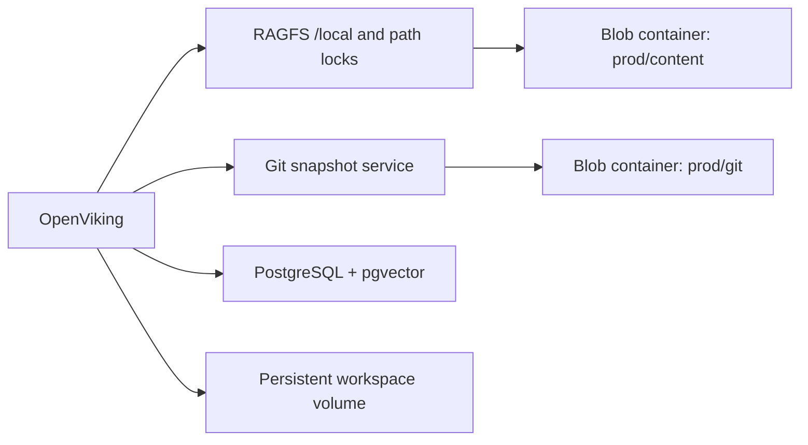

# Store OpenViking content and Git snapshots in Azure Blob

This guide applies to source builds containing the native `azureblobfs` changes and one active OpenViking instance. Ordinary Blob storage (`flat`) remains the default. Accounts with hierarchical namespace enabled can explicitly select `hns`. Keep a persistent workspace volume for SQLite queues and snapshot logs. HNS has passed real Azure test-container acceptance using Azure CLI authentication, covering directory rename, path locks, and Git snapshot restoration. Production managed identity, private networking, and customer-scale acceptance still require the deployment environment.



## Configure the container and identity

Create the container first. Grant the application's managed identity **Storage Blob Data Contributor** at container scope. Verify HTTPS access and private endpoint DNS from the application host. Use exclusive prefixes with one active content writer; stop the old instance before failover. [Microsoft Entra authorization for Blob Storage](https://learn.microsoft.com/en-us/azure/storage/blobs/authorize-access-azure-active-directory)

Merge these fields into `ov.conf`, preserving database, model, and server settings. Replace the account, container, and workspace. For a user-assigned managed identity, add its `client_id` inside `auth`.

```json
{
  "storage": {
    "workspace": "/var/lib/openviking/data",
    "agfs": {
      "backend": "azure_blob",
      "pathlock": { "provider": "filesystem" },
      "azure_blob": {
        "account_url": "https://contosoprod.blob.core.windows.net",
        "container": "openviking",
        "prefix": "prod/content",
        "namespace": "flat",
        "auth": { "type": "managed_identity" }
      }
    }
  },
  "git": {
    "enabled": true,
    "backend": "azure_blob",
    "azure_blob": { "prefix": "prod/git" }
  }
}
```

Git inherits the content store's account, container, identity, and namespace. Prefixes in the same container must not contain each other. Stores using the same account must agree on namespace mode. Content lives under `nodes/`; flat-mode move journals live under `operations/`. Only OV should modify these objects and metadata. Switching configuration does not migrate existing content or Git history. Coordinate migration with pgvector and workspace backups.

## Configure HNS and local authentication

Confirm hierarchical namespace is enabled in the Azure storage account configuration, then set `namespace` to `hns`. Keep the Blob account URL: the backend derives the matching DFS endpoint. Allow both Blob and DFS endpoints through networking and private DNS. This option neither enables HNS on the account nor migrates flat-mode directory markers.

HNS uses DFS for real directories, listing, server-side rename, and recursive deletion. File bytes use Blob APIs. Rename checks source and destination ETags, follows continuation tokens, and reconciles lost responses using a transaction ID. OV permission metadata remains virtual: `chmod` does not change Azure ACLs. Multiple active content writers and ACL administration are outside this implementation's scope.

A normal local Mac has no Azure runtime managed identity. Use Azure CLI authentication locally; retain managed identity on production Azure hosts. A managed identity's client ID alone does not let a local machine obtain that identity. [Interactive Azure CLI login](https://learn.microsoft.com/en-us/cli/azure/authenticate-azure-cli-interactively)

```bash
# macOS with Homebrew installed
brew install azure-cli
az login
az account show --query '{subscription:name,user:user.name,tenant:tenantId}' -o json
```

An administrator must grant the signed-in user **Storage Blob Data Contributor** on the test container. Management roles do not automatically grant Blob data access. [Authorize CLI data operations](https://learn.microsoft.com/en-us/azure/storage/blobs/authorize-data-operations-cli)

The Chinese portal labels this role “存储 Blob 数据参与者”. Storage accounts and containers are separate resources: after creating the account, confirm the test container exists under **Data storage → Containers**. With multiple subscriptions, add `"subscription": "your-subscription-id"` inside `auth` to select the CLI account without changing its global default. Git inherits this field.

Replace `storage.agfs.azure_blob` with the following fields, using your test account and container. Git continues to inherit these settings with a separate prefix.

```json
{
  "account_url": "https://contosotest.blob.core.windows.net",
  "container": "ov-acceptance",
  "prefix": "acceptance/content",
  "namespace": "hns",
  "auth": { "type": "azure_cli" }
}
```

## Build and start

Build from the modified source using the project's supported Python, Rust, and native toolchain. Use a clean distribution output directory so the installation matches only the newly built wheel.

```bash
uv build --wheel
uv pip install --reinstall-package openviking dist/openviking-*.whl
python -c 'from openviking.pyagfs import get_binding_client; C, _ = get_binding_client(); assert "azureblobfs" in C().list_plugins()'
openviking-server --config /etc/openviking/ov.conf
```

Flat directory moves span multiple blobs and block other content operations until completion. Large moves therefore increase request latency. Workspace encryption protects content by account; Git objects retain the existing snapshot format and require their own access control and encryption policy.

## Verify locks, snapshots, and restoration

Run against an isolated test container. Tests create random prefixes under `ov-tests/` and retain them for inspection. Install the modified native binding before running Python tests. For managed identity on an Azure host, set `AZURE_CLIENT_ID` when using a user-assigned identity.

```bash
export OV_AZURE_TEST_URL=https://contosotest.blob.core.windows.net
export OV_AZURE_TEST_CONTAINER=ov-acceptance
cargo test --locked -p ragfs --features azure --test azure_blob -- --ignored
cargo test --locked -p ragfs --features azure --lib azure_recover_interrupted_move -- --ignored
python -m pytest -q tests/agfs/test_azure_blob_binding.py
```

For actual HNS acceptance after local CLI login, keep those account and container variables and run the following. The flat-mode move-journal recovery test does not apply to HNS.

```bash
export OV_AZURE_TEST_NAMESPACE=hns
export OV_AZURE_TEST_AUTH=azure_cli
# Set your actual subscription ID when selecting among multiple subscriptions
export OV_AZURE_TEST_SUBSCRIPTION=your-subscription-id
cargo test --locked -p ragfs --features azure --test azure_blob -- --ignored
python -m pytest -q tests/agfs/test_azure_blob_binding.py
```

Acceptance checks exclusive lock creation, stale-owner update/delete rejection, competing commits from the same parent, history reads after reopening, and forward restoration of worktree bytes. Python tests exercise actual mounts, tree-lock conflicts, directory rename, snapshot restoration, and encrypted writes.

The credential-free HNS fixture exercises SDK HTTP requests, ETag races, pagination, and lost rename responses against an in-memory server. It does not verify Azure's service implementation, RBAC, or networking.

```bash
python3 crates/ragfs/tests/support/hns_fixture.py cargo test --locked -p ragfs --features azure --test azure_blob -- --ignored
OV_HNS_FIXTURE_FAULT=lost-rename-response python3 crates/ragfs/tests/support/hns_fixture.py cargo test --locked -p ragfs --features azure --test azure_blob -- --ignored
python3 crates/ragfs/tests/support/hns_fixture.py python -m pytest -q tests/agfs/test_azure_blob_binding.py
```

Flat-mode tests can use Azurite with a loopback account URL and a short-lived container SAS in `OV_AZURE_TEST_SAS`. Real deployment acceptance still requires the customer's Azure environment.

## Troubleshoot

- **403:** Check identity, role scope, propagation, and account network rules. The container must already exist.
- **Choose the namespace mode:** The deployment operator must confirm the account's HNS setting: use `namespace: flat` (the default) when disabled, or `namespace: hns` when enabled. The backend makes a best-effort check and does not switch modes automatically. When account information returns 403, the current flat mode continues with the configured setting, while HNS verifies capability through a DFS root access-control query. A successful mount does not replace deployment-time confirmation.
- **HNS configured on a non-HNS account:** A namespace mismatch or DFS capability-query error may occur. Confirm that the configuration targets the intended account. If it uses ordinary Blob storage, set both content and Git namespaces to `flat` (Git inherits the content setting by default), restart, and verify reads, writes, path locks, and snapshot restoration under an isolated prefix. Changing configuration neither enables account HNS nor migrates existing data.
- **HNS is enabled, but requests fail with 403 or endpoint errors:** Check the runtime identity, container permissions, and access to both Blob and DFS endpoints from the application host. Check the corresponding DNS when using private endpoints. A 403, timeout, or DNS failure does not prove that HNS is disabled; do not switch to `flat` on that evidence alone.
- **An HNS account used the flat default and child-path writes fail:** Stop writes and check for ordinary Blob directory markers. Selecting `hns` does not convert those markers into native directories. For disposable test data, repeat acceptance under a new isolated prefix; back up existing business data and plan its migration first.
- **Flat move recovery required:** Stop the old writer and reopen with the same configuration. Recovery checks source and published target ETags before conditional deletion. If another writer changed objects, preserve both paths and the operation journal for investigation.
- **Interrupted large HNS operation:** Continuation progress currently stays in process memory. After a crash or restart, reconcile source, destination, and the directory tree before resuming writes. The flat move-journal procedure does not apply. Large-directory crash recovery still requires real-cloud acceptance.
- **Missing history after switching:** Verify content/Git prefixes, containers, and identity. Recovery drills must include the workspace volume and PostgreSQL. Append, offset writes, and truncation can read existing objects into memory; validate peak memory with representative object sizes.
