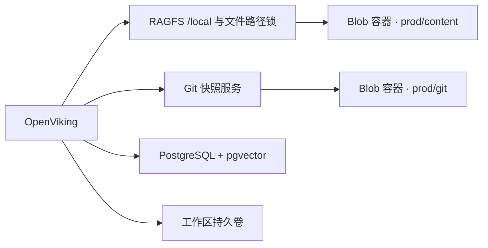

# 将 OpenViking 内容和 Git 快照存入 Azure Blob

适用于包含本次 `azureblobfs` 原生插件改动的源码构建和单活动 OpenViking 实例。默认使用普通 Blob（`flat`），启用分层命名空间的账户可显式选择 `hns`。工作区保留持久卷，供 SQLite 队列、快照日志等本地状态使用。HNS 已通过真实 Azure 测试容器的 Azure CLI 身份验收，覆盖目录改名、路径锁和 Git 快照恢复。生产托管身份、私网和客户规模验收仍需在部署环境完成。



## 配置容器和身份

预建容器，向 OV 运行环境的托管身份授予该容器的 **Storage Blob Data Contributor**。确认实例可以通过 HTTPS 访问存储账户端点。使用私有端点时，在实例所在网络验证 DNS。应用接管两个专用前缀，只允许一个活动实例管理内容前缀。主备切换时先停止旧实例写入。[Azure Blob 的 Microsoft Entra 授权](https://learn.microsoft.com/en-us/azure/storage/blobs/authorize-access-azure-active-directory)

将下面的字段合并进已有的 `ov.conf`，保留原有的数据库、模型和服务配置。替换账户地址、容器和工作区路径。系统分配的身份使用以下配置，用户分配的身份可在 `auth` 下增加 `client_id`。

```json
{
  "storage": {
    "workspace": "/var/lib/openviking/data",
    "agfs": {
      "backend": "azure_blob",
      "pathlock": { "provider": "filesystem" },
      "azure_blob": {
        "account_url": "https://contosoprod.blob.core.windows.net",
        "container": "openviking",
        "prefix": "prod/content",
        "namespace": "flat",
        "auth": { "type": "managed_identity" }
      }
    }
  },
  "git": {
    "enabled": true,
    "backend": "azure_blob",
    "azure_blob": { "prefix": "prod/git" }
  }
}
```

Git 继承主存储的账户、容器、身份和 `namespace`。在同一容器内，两个前缀须互不包含。同一账户的内容和 Git 配置必须使用相同命名空间模式。内容存放在内容前缀的 `nodes/` 下，普通 Blob 的 `operations/` 是移动日志。只有 OV 可以修改这些对象及其元数据。更换后端只会切换读写位置；已有实例迁移时需单独迁移正文、Git 历史并核对 pgvector 和工作区备份。

## 配置 HNS 和本地开发者登录

在 Azure 门户的存储账户配置页确认“分层命名空间”已启用，再将 `namespace` 设置为 `hns`。保留 Blob 账户 URL，后端会推导同账户的 `dfs.core.windows.net` 端点。网络和私有 DNS 需要同时允许 Blob 与 DFS 端点。此字段不会替你开启账户 HNS，也不会迁移普通 Blob 的目录标记。

HNS 使用 DFS API 创建真实目录、列目录、服务端改名及递归删除，文件内容仍使用 Blob API。改名校验源和目标的 ETag，并处理服务端 continuation。响应丢失后使用事务标识核对目标。目录权限元数据仍遵循 OV 的文件系统接口，`chmod` 不会修改 Azure ACL。多进程内容写入和 Azure ACL 管理不在本次范围内。

普通本地 Mac 没有 Azure 运行环境提供的托管身份。本地测试使用 Azure CLI 登录，并将 `auth` 改为 `{"type": "azure_cli"}`。生产 Azure 主机继续使用 `managed_identity`。用户分配身份的 Client ID 本身不能让本地电脑取得该身份。[Azure CLI 交互登录](https://learn.microsoft.com/en-us/cli/azure/authenticate-azure-cli-interactively)

```bash
# macOS，已安装 Homebrew
brew install azure-cli
az login
az account show --query '{subscription:name,user:user.name,tenant:tenantId}' -o json
```

向登录用户授予测试容器范围的 **Storage Blob Data Contributor**。在 Azure 门户的容器“访问控制 (IAM)”中添加角色分配；没有授权权限时交由管理员操作。账户管理角色不自动赋予 Blob 数据权限。[CLI 数据访问授权](https://learn.microsoft.com/en-us/azure/storage/blobs/authorize-data-operations-cli)

中文角色名称为“存储 Blob 数据参与者”。存储账户和容器是独立资源：创建账户后，在“数据存储 → 容器”确认测试容器确实存在。多订阅环境可在 `auth` 中添加 `"subscription": "你的订阅 ID"`，显式选择开发者身份的订阅，不修改 CLI 全局默认值。Git 会继承该字段。

以下字段替换 `storage.agfs.azure_blob`，账户和容器替换为自己的测试环境；Git 继续继承这些字段并使用独立前缀。

```json
{
  "account_url": "https://contosotest.blob.core.windows.net",
  "container": "ov-acceptance",
  "prefix": "acceptance/content",
  "namespace": "hns",
  "auth": { "type": "azure_cli" }
}
```

## 构建并启动

从包含本改动的源码根目录，使用项目支持的 Python、Rust 和原生构建工具构建发行包。以下检查可确认正在执行的 Python 环境已加载 Azure 原生插件。

```bash
uv build --wheel
uv pip install --reinstall-package openviking dist/openviking-*.whl
python -c 'from openviking.pyagfs import get_binding_client; C, _ = get_binding_client(); assert "azureblobfs" in C().list_plugins()'
openviking-server --config /etc/openviking/ov.conf
```

在空的发行包输出目录执行构建，确保安装命令只匹配本次生成的 wheel。部署多个副本时使用单活动切换。普通目录改名涉及多个 Blob，执行期间内容挂载会等待移动完成；大目录的改名会增加其他请求延迟。加密包装按账户保护工作区内容。Git 对象沿用现有快照格式，Git 前缀应单独纳入存储访问控制和加密策略。

## 验收路径锁、快照和恢复

在具有托管身份的 Azure 主机上指定**独立测试容器**，从源码根目录执行以下命令。测试在 `ov-tests/` 下创建随机前缀，并保留数据供核查。用户分配的身份可另行设置 `AZURE_CLIENT_ID`。运行 Python 测试前安装含本改动的 native binding。

```bash
export OV_AZURE_TEST_URL=https://contosotest.blob.core.windows.net
export OV_AZURE_TEST_CONTAINER=ov-acceptance
cargo test --locked -p ragfs --features azure --test azure_blob -- --ignored
cargo test --locked -p ragfs --features azure --lib azure_recover_interrupted_move -- --ignored
python -m pytest -q tests/agfs/test_azure_blob_binding.py
```

HNS 本地登录后的真实云验收，使用上述测试账户与容器变量，再执行以下命令。普通 Blob 的移动日志恢复用例不适用于 HNS。

```bash
export OV_AZURE_TEST_NAMESPACE=hns
export OV_AZURE_TEST_AUTH=azure_cli
# 多订阅环境按需指定实际订阅 ID
export OV_AZURE_TEST_SUBSCRIPTION=你的订阅ID
cargo test --locked -p ragfs --features azure --test azure_blob -- --ignored
python -m pytest -q tests/agfs/test_azure_blob_binding.py
```

HNS 无凭据契约测试使用内存 HTTP fixture，不访问 Azure。它验证适配器的请求、ETag 竞争、分页和恢复行为，不能替代真实 HNS 服务验收。

```bash
python3 crates/ragfs/tests/support/hns_fixture.py cargo test --locked -p ragfs --features azure --test azure_blob -- --ignored
OV_HNS_FIXTURE_FAULT=lost-rename-response python3 crates/ragfs/tests/support/hns_fixture.py cargo test --locked -p ragfs --features azure --test azure_blob -- --ignored
python3 crates/ragfs/tests/support/hns_fixture.py python -m pytest -q tests/agfs/test_azure_blob_binding.py
```

锁竞争测试要求独占创建只有一个赢家，旧令牌的续写和删除均失败。快照测试要求从同一父提交竞争的两个提交只发布一个，新客户端能读取旧提交，恢复操作产生以当前 HEAD 为父的新提交，并还原工作树字节。Python 验收覆盖实际挂载、加密覆盖写与快照读取。可用 Azurite 复测相同用例，将 URL 换为回环地址并通过 `OV_AZURE_TEST_SAS` 提供测试容器的短期 SAS。生产身份及网络验收应在客户 Azure 环境执行。

## 排查失败

- **403**。核对身份、角色授予范围、角色传播状态和账户网络规则。容器需预先建好。
- **如何选择命名空间模式**。由部署方确认账户实际 HNS 设置：未启用时使用 `namespace: flat`（默认），启用时使用 `namespace: hns`。后端尽力检测配置是否匹配，不自动切换模式。账户信息查询返回 403 时，当前 `flat` 模式继续使用配置，`hns` 模式通过 DFS 根目录访问控制查询验证能力；因此挂载成功不能代替部署前确认。
- **配置了 HNS，但账户未开启 HNS**。可能出现命名空间不匹配或 DFS 能力查询错误。确认配置指向正确账户；若该账户确实使用普通 Blob，将内容和 Git 的命名空间统一改为 `flat`（Git 默认继承内容配置），重启后在隔离前缀执行读写、路径锁和快照恢复验收。修改配置不会开启账户 HNS，也不会迁移已有数据。
- **账户已开启 HNS，仍出现 403 或端点错误**。核对运行身份、容器权限，以及运行主机能否访问 Blob 和 DFS 双端点；使用私有终结点时同时检查对应 DNS。403、超时或 DNS 失败不能证明账户未开启 HNS，不应据此改成 `flat`。
- **HNS 账户误用了默认 flat 模式，子路径写入失败**。先停止写入，确认是否已产生普通 Blob 目录标记。改为 `hns` 不会把这些标记转换成原生目录；空测试数据可换用新的隔离前缀重新验收，已有业务数据需先备份并安排迁移。
- **HNS 大目录操作中断**。当前 continuation 在进程内处理，尚未持久化跨进程恢复状态。中断或重启后先核对源、目标和实际目录树，再恢复写入；不能按普通 Blob 移动日志恢复流程处理。大目录中断恢复仍需真实云验收。
- **挂载要求移动恢复**。停止旧实例后，以相同配置重新打开挂载。恢复会校验源 ETag 和已发布目标 ETag，再继续条件删除。若发现第三方改写，保留源、目标及 `operations/` 日志供核对，避免手工删除日志后继续写入。
- **切换后缺少历史**。检查内容和 Git 前缀、Git 的容器和当前账号。恢复演练还需覆盖工作区卷与 PostgreSQL。追加、偏移写和截断可能在内存中读取现有对象，按业务对象大小验证内存峰值。
